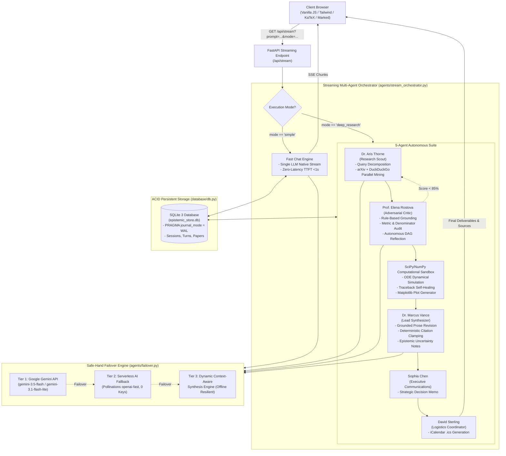

# Technical Requirements Document (TRD)
## genAI: Autonomous Multi-Agent Epistemic Architecture

- **Document Version:** 2.4.0
- **Architectural Paradigm:** Event-Driven Server-Sent Events (SSE) + DAG Multi-Agent State Machine
- **Runtime Environment:** Python 3.11+ ASGI (FastAPI / Uvicorn)
- **Status:** Approved / Active

---

## 1. System Architecture Diagram



---

## 2. Technology Stack & Runtime Specifications

### 2.1 Backend Core
- **Language:** Python 3.11+
- **Web Framework:** FastAPI (v0.115+) & Starlette ASGI
- **ASGI Server:** Uvicorn with asynchronous event loop (`asyncio`)
- **Database Engine:** SQLite 3 in WAL mode (`PRAGMA journal_mode = WAL; PRAGMA synchronous = NORMAL;`)
- **Scientific Computing:** `numpy` (v1.26+), `scipy` (v1.14+), `matplotlib` (v3.9+)
- **Data Validation:** Pydantic v2 (models, input schemas, response contracts)

### 2.2 LLM Providers & Failover Hierarchy (Safe-Hand Architecture)
1. **Tier 1 (Primary):** Google Gemini via official Google GenAI SDK (`google-genai`):
   - Priority sequence: `gemini-3.5-flash` -> `gemini-3.1-flash-lite` -> `gemini-3.5-flash-lite` -> `gemini-flash-lite-latest`.
   - Native chunk streaming via `client.models.generate_content_stream()`.
2. **Tier 2 (Secondary):** Free Serverless Pollinations API (`https://text.pollinations.ai/`):
   - Zero-key cloud failover utilizing `openai-fast` architecture when Gemini quota is exhausted.
3. **Tier 3 (Tertiary Offline):** Dynamic Context-Aware Synthesis Engine:
   - Pure local heuristic algorithmic synthesis extracting passages directly from retrieved search snippets. Guarantees 0-downtime execution even under total internet disconnection.

### 2.3 Retrieval & Document Extraction
- **Web Retrieval:** DuckDuckGo Search API with instant zero-scrape heuristic fallback.
- **Academic Retrieval:** arXiv API XML endpoint parsing Title, Authors, Abstract, DOI, and Published Date.
- **PDF Extraction:** `pypdf` / `pdfplumber` with mathematical equation and table preservation.

### 2.4 Frontend Runtime & Client Libraries
- **Architecture:** Zero-bundler, ultra-lightweight Vanilla ES6+ JavaScript.
- **CSS Engine:** Tailwind CSS (modern dark-mode palette via JIT CDN).
- **Markdown & Math Rendering:**
  - `Marked.js` (custom link renderer enforcing `target="_blank"` and `rel="noopener noreferrer"`).
  - `KaTeX` (inline `$..$` and display `$$..$$` KaTeX auto-render engine).
- **Streaming Interface:** EventSource SSE consumer with custom `WordStreamer` adaptive typewriter pacing (100 FPS).

---

## 3. Server-Sent Events (SSE) Protocol Contract

All research communications between the client and backend stream over `GET /api/stream`. Every message follows the standard SSE specification:
```
id: <integer>
data: <json_string>
```

### Event Types Catalog:

| Event Type | Producer | Payload Fields | Purpose |
| :--- | :--- | :--- | :--- |
| `pipeline_init` | Orchestrator | `prompt`, `mode`, `engine`, `agents` | Signals start of request and registers agent roster. |
| `agent_start` | Orchestrator | `step`, `agent_id`, `agent`, `model`, `task` | Notifies client that an agent has taken active focus. |
| `agent_status_change` | Agent | `agent_id`, `status`, `action` | Updates agent lifecycle state (`working`, `completed`). |
| `agent_thought` | Agent | `agent`, `thought` | Emits internal deliberative reasoning to UI sidebar. |
| `agent_handoff` | Agent | `from_agent`, `to_agent`, `message` | Visual handoff banner indicating data transfer between agents. |
| `query_expansion` | Scout | `queries`, `count` | Displays sub-queries used for multi-query snowballing. |
| `sources_gathered` | Scout | `sources` (list of dictionaries) | Delivers structured source catalog (id, title, url, domain). |
| `cross_check_result`| Critic | `score`, `verdict`, `grounding_ratio`, `critique_points` | Provides peer-review score and audit mandates. |
| `visual_artifact` | Sandbox | `type`, `plot_path`, `plot_base64`, `caption`, `metrics` | Delivers dynamical simulation chart to the reading canvas. |
| `content_chunk` | Synthesizer | `chunk`, `full_content`, `provider` | Streams prose word-by-word with live markdown formatting. |
| `agent_deliverable` | Synthesizer | `agent_id`, `type`, `data` | Transmits finalized research paper, memo, or invite. |
| `followup_questions`| Synthesizer | `questions` (list of 3 strings) | Supplies frontier exploratory follow-up questions. |
| `pipeline_complete` | Orchestrator | `duration`, `status`, `word_count`, `sources_count` | Final execution telemetry. |

---

## 4. Test-Time Compute & Epistemic Verification Engine

Located in `agents/test_time_compute.py`, this subsystem implements the test-time scaling principles from Snell et al. (Google DeepMind, 2024):

### 4.1 Process Grounding Verifier (PRM Proxy)
- Evaluates intermediate draft claims against the retrieved empirical context.
- Extracts quantitative values matching:
  - `\b\d+(?:\.\d+)?\s*(?:%|percent)\b`
  - `\b\d+(?:-\d+)?x\s*(?:slower|faster)\b`
  - `\b\d+\s*x\s*(?:H100|A100|B200|GPU)\b`
  - `\b\d+(?:-\d+)?\s*(?:years?|months?)\s*(?:faster|acceleration)\b`
- Evaluates whether the exact numerical token or its base integer appears in the retrieved source context.

### 4.2 Deterministic Citation Sanitizer (`audit_and_sanitize_citations`)
```python
def audit_and_sanitize_citations(cls, text: str, valid_source_count: int) -> Tuple[str, Dict[str, Any]]:
    # 1. Matches all regex: r'\[(\d+)\]'
    # 2. If valid_source_count == 0: Strips brackets
    # 3. If citation index > valid_source_count: Clamps to valid_source_count
    # 4. If citation index < 1: Clamps to 1
    # 5. Calculates coverage_ratio = len(unique_cited) / valid_source_count
    # 6. Returns sanitized text + audit telemetry in <1ms
```

### 4.3 Denominator & Baseline Guardrails
The system prompt of `Prof. Elena Rostova` and `Dr. Marcus Vance` enforces:
1. Every percentage (e.g., *"10–15% success rate"*) must specify the denominator, study population, and phase transition.
2. Speculative hardware requirements for closed-source APIs must be explicitly flagged as proprietary rather than asserted as fact.
3. Unverified claims must be labeled with:
   `> ⚠️ Epistemic Note: [Specific unverified condition disclosed]`.

---

## 5. Concurrency, Storage & Security Specifications

### 5.1 SQLite WAL Concurrency
- `PRAGMA journal_mode = WAL;` allows simultaneous readers while a single background worker writes completed research turns.
- `PRAGMA synchronous = NORMAL;` delivers maximum I/O throughput with safety against application crashes.
- Database connection timeout is set to `30.0` seconds to eliminate `database locked` exceptions under concurrent multi-user load.

### 5.2 Computational Sandbox Security
- When executing dynamically generated SciPy/NumPy simulation scripts in `tools/tools.py`:
  - Scripts execute via isolated subprocesses with a strict 15-second timeout.
  - Built-in regex filters strip dangerous primitives: `os.system`, `subprocess`, `shutil.rmtree`, `sys.exit`, and socket bindings.
  - Scripts operate strictly on scientific libraries (`numpy`, `scipy.integrate.solve_ivp`, `matplotlib.pyplot`).

### 5.3 Abort & Cleanup Protocol
- When the user clicks the Stop action button:
  - The client instantly closes `EventSource`.
  - The client invokes `cleanupTurnStoppedState(turnId)` to strip all `animate-spin` and `animate-pulse` classes from the DOM.
  - The backend streaming generator detects client disconnection (`asyncio.CancelledError` or broken pipe) and immediately terminates subprocess tasks and LLM generation.
