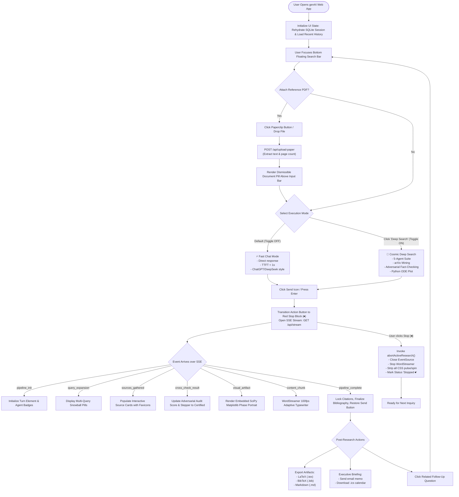
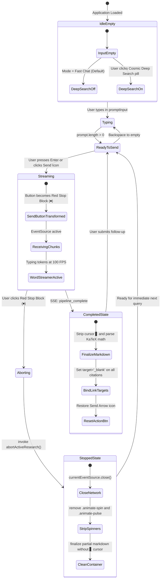

# Application Flow & User Journeys (AppFlow)
## genAI: End-to-End User Experience & Interaction State Machine

- **Document Version:** 2.4.0
- **Scope:** UX Interaction Flows, Client State Transitions, SSE Event Handling, and Error Recovery
- **Status:** Approved / Active

---

## 1. System End-to-End User Experience Flow

---

## 2. Sequence Diagram: Multi-Agent Handoff & Deliberation

This diagram details the exact order of asynchronous events during a **Deep Search** inquiry:

```mermaid
sequenceDiagram
    autonumber
    actor User
    participant UI as Browser Client (index.html)
    participant API as FastAPI Backend (app.py)
    participant Orch as Stream Orchestrator
    participant Scout as Dr. Aris Thorne (Scout)
    participant Critic as Prof. Elena Rostova (Critic)
    participant Sandbox as Python SciPy Sandbox
    participant Vance as Dr. Marcus Vance (Synthesizer)
    participant Comms as Sophia Chen (Comms)
    participant DB as SQLite WAL Store

    User->>UI: Enter prompt & click Deep Search (Send)
    UI->>UI: Switch action button to pulsing Red Block (⏹)
    UI->>API: GET /api/stream?prompt=...&mode=deep_research
    API->>Orch: stream_multi_agent_pipeline(...)
    Orch-->>UI: SSE: pipeline_init (Registered 5 agents)

    rect rgb(15, 23, 42)
        Note over Orch,Scout: STAGE 1: Literature Mining & Snowballing
        Orch-->>UI: SSE: agent_start (Dr. Aris Thorne)
        Scout->>Scout: Decompose prompt into sub-queries
        Orch-->>UI: SSE: query_expansion (Sub-queries list)
        Scout->>Scout: Parallel search (DuckDuckGo + arXiv API)
        Orch-->>UI: SSE: sources_gathered (Indexed sources catalog)
        Orch-->>UI: SSE: agent_status_change (Scout -> Completed)
    end

    rect rgb(30, 20, 50)
        Note over Orch,Critic: STAGE 2: Adversarial Audit & Grounding
        Orch-->>UI: SSE: agent_handoff (Thorne -> Rostova)
        Orch-->>UI: SSE: agent_start (Prof. Elena Rostova)
        Critic->>Critic: Rule-based verification & metric audit
        opt Grounding Score < 85%
            Critic->>Scout: Trigger Autonomous Reflection Pass
            Scout->>Critic: Return Fortified Literature Context
        end
        Orch-->>UI: SSE: cross_check_result (Score: 96/100, Verified)
        Orch-->>UI: SSE: agent_status_change (Critic -> Completed)
    end

    rect rgb(20, 30, 40)
        Note over Orch,Sandbox: STAGE 3: Computational Simulation (Optional)
        opt Equations detected in research
            Orch->>Sandbox: run_numerical_verification(equations, topic)
            Sandbox->>Sandbox: Execute ODE solve_ivp & generate plot
            Sandbox-->>Orch: Return Base64 PNG plot & extracted metrics
            Orch-->>UI: SSE: visual_artifact (Matplotlib phase portrait)
        end
    end

    rect rgb(15, 30, 50)
        Note over Orch,Vance: STAGE 4: Conversational Synthesis & Citation Locking
        Orch-->>UI: SSE: agent_handoff (Rostova -> Vance)
        Orch-->>UI: SSE: agent_start (Dr. Marcus Vance)
        Vance->>API: Native Gemini generate_content_stream()
        loop Streaming Chunks
            API-->>Orch: Token chunk
            Orch-->>UI: SSE: content_chunk (token)
            UI->>UI: WordStreamer typewriter render (100fps)
        end
        Orch->>Orch: Deterministic Citation Sanitizer (clamp out-of-bounds [n])
        Orch->>Orch: Append deterministic bibliography
        Orch-->>UI: SSE: agent_deliverable (Research paper markdown)
        Orch-->>UI: SSE: agent_status_change (Vance -> Completed)
    end

    rect rgb(25, 20, 35)
        Note over Orch,Comms: STAGE 5: Executive Correspondence & Logistics
        Orch->>Comms: Formulate executive briefing email
        Orch->>Orch: Generate RFC-5545 iCalendar invite (.ics)
        Orch-->>UI: SSE: followup_questions (3 research questions)
        Orch-->>UI: SSE: pipeline_complete (Total duration & word count)
    end

    Orch->>DB: save_turn(session_id, turn_id, research, sources, deliverables)
    DB-->>Orch: Turn persisted (ACID WAL mode)
    UI->>UI: Unlock Send action button
```

---

## 3. Client Search Bar State Machine

The floating bottom search bar coordinates all user inputs, mode selections, and cancellation events:

---

## 4. Detailed Step-by-Step User Journey Scenarios

### Scenario A: Instant Fast Chat
1. User enters: *"What is the difference between causal and windowed attention in video transformers?"*
2. User leaves "Deep Search" toggle **OFF**.
3. User clicks Send (or presses `Enter`).
4. **Immediate Feedback (<1s):** The input clears, the query is rendered as a user chat bubble, and Gemini streaming tokens begin typing out immediately.
5. In $< 3.5$ seconds, the complete, structured explanation is fully rendered with syntax-highlighted math blocks.
6. Action button reverts to the cyan send arrow.

### Scenario B: Deep Academic Investigation with PDF Grounding
1. User clicks the paperclip icon in the search bar and uploads `diffusion_survey.pdf`.
2. A dismissible chip `📑 diffusion_survey.pdf (18p) ✕` appears directly above the search bar.
3. User clicks the **Deep Search** button. The button transforms into the **Cosmic Violet** glowing state, and the entire search bar gains an ambient violet aura.
4. User enters: *"Evaluate whether Sora 2 and Wan 2.5 architecture claims align with this paper."*
5. User presses `Enter`.
6. **Execution Telemetry:**
   - Multi-Agent Drawer expands showing Dr. Aris Thorne deploying 4 parallel arXiv and web queries.
   - 8 sources appear with live site favicons.
   - Prof. Elena Rostova audits the draft, enforces denominator baselines, and rejects speculative GPU numbers.
   - SciPy dynamical simulator executes ODE phase space trajectory and embeds `Figure 1`.
   - Dr. Marcus Vance streams the final peer-reviewed research answer with citations `[1]`, `[2]`, accompanied by `> ⚠️ Epistemic Note:` uncertainty disclosures.
   - Verified bibliography is locked at the bottom.
7. Turn automatically persists to SQLite database.

### Scenario C: Aborting Mid-Stream
1. User initiates a Deep Search query.
2. At second 4, the user notices a typo in their prompt.
3. User clicks the pulsing **Red Stop Block (⏹)**.
4. **Instant Cancellation:**
   - `EventSource` is closed immediately.
   - Streaming stops instantly.
   - Any active agent pod badges (`ACTIVE ⚡`) transition to `STOPPED` with no leftover pulsing CSS.
   - The status badge updates to `⏹ Stopped`.
   - The action button reverts to the Send Arrow.
   - The user immediately types their corrected prompt and clicks Send with zero UI lockup.
