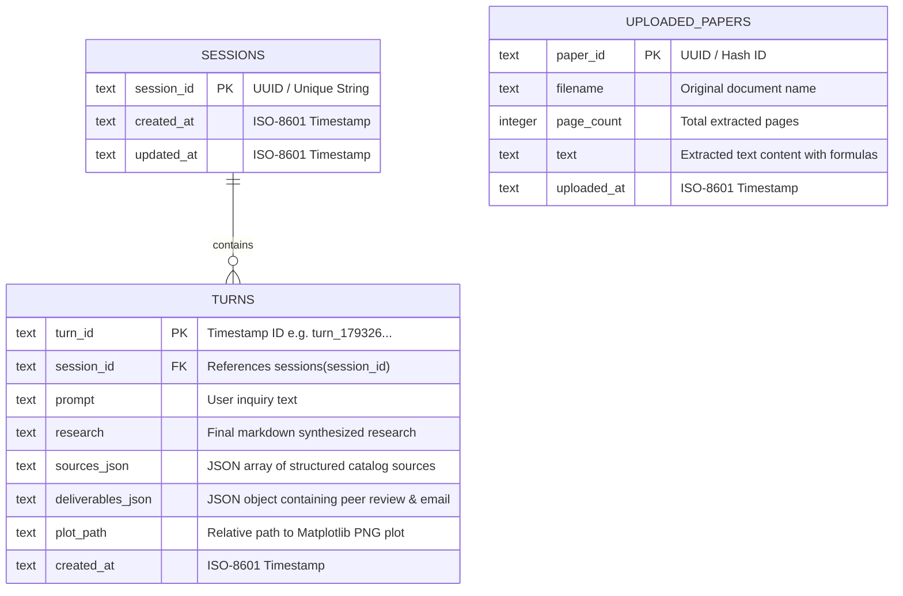

# Backend Schema & Data Architecture
## genAI: Relational Database, API Contracts & Event Specifications

- **Document Version:** 2.4.0
- **Database Engine:** SQLite 3 (WAL Mode Enabled)
- **API Architecture:** RESTful JSON + Server-Sent Events (SSE)
- **Status:** Approved / Active

---

## 1. Relational Database Schema (SQLite 3 WAL)

The persistence layer (`database/db.py`) maintains conversation memory, scientific deliverables, and reference document chunks across server restarts:



### 1.1 Data Definition Language (DDL)
```sql
PRAGMA journal_mode = WAL;
PRAGMA synchronous = NORMAL;

-- Sessions Table
CREATE TABLE IF NOT EXISTS sessions (
    session_id TEXT PRIMARY KEY,
    created_at TEXT NOT NULL,
    updated_at TEXT NOT NULL
);

-- Conversational Research Turns Table
CREATE TABLE IF NOT EXISTS turns (
    turn_id TEXT PRIMARY KEY,
    session_id TEXT NOT NULL,
    prompt TEXT NOT NULL,
    research TEXT,
    sources_json TEXT,
    deliverables_json TEXT,
    plot_path TEXT,
    created_at TEXT NOT NULL,
    FOREIGN KEY (session_id) REFERENCES sessions(session_id) ON DELETE CASCADE
);

CREATE INDEX IF NOT EXISTS idx_turns_session ON turns(session_id);
CREATE INDEX IF NOT EXISTS idx_turns_created ON turns(created_at);

-- Uploaded Reference Papers Table
CREATE TABLE IF NOT EXISTS uploaded_papers (
    paper_id TEXT PRIMARY KEY,
    filename TEXT NOT NULL,
    page_count INTEGER NOT NULL,
    text TEXT NOT NULL,
    uploaded_at TEXT NOT NULL
);
```

---

## 2. Pydantic Domain Schemas (Python Models)

Located in `verification/schemas.py` and `database/db.py`:

```python
from enum import Enum
from typing import List, Optional, Dict, Any
from pydantic import BaseModel, Field

class ExecutionMode(str, Enum):
    SIMPLE = "simple"
    DEEP_RESEARCH = "deep_research"
    ACADEMIC = "academic"
    ENTERPRISE = "enterprise"

class SourceItem(BaseModel):
    id: int = Field(description="Sequential 1-based catalog index")
    title: str = Field(description="Title of research paper or web page")
    url: str = Field(description="Direct URL or DOI link")
    domain: str = Field(description="Source domain e.g. arxiv.org")
    snippet: str = Field(default="", description="Key extracted evidence passage")
    year: str = Field(default="2026", description="Publication year")

class PeerReviewDeliverable(BaseModel):
    score: int = Field(ge=0, le=100, description="Audit score out of 100")
    verdict: str = Field(description="VERIFIED & GROUNDED or REVISION REQUIRED")
    provider: str = Field(description="Auditing protocol identifier")
    grounding_ratio: int = Field(description="Percentage of verified metrics")
    verified_metrics: List[str] = Field(default_factory=list)
    unverified_metrics: List[str] = Field(default_factory=list)
    critique_points: List[str] = Field(default_factory=list)

class TurnRecord(BaseModel):
    turn_id: str
    session_id: str
    prompt: str
    research: str
    sources: List[SourceItem] = Field(default_factory=list)
    deliverables: Dict[str, Any] = Field(default_factory=dict)
    plot_path: Optional[str] = None
    created_at: str
```

---

## 3. RESTful API Endpoint Contracts

### 3.1 Streaming Research Endpoint
- **Route:** `GET /api/stream`
- **Protocol:** Server-Sent Events (`text/event-stream`)
- **Query Parameters:**
  - `prompt` (string, required): The user's research inquiry.
  - `recipient` (string, optional): Colleague or stakeholder name for the executive brief. Defaults to `"Valued Stakeholder"`.
  - `mode` (string, optional): `"simple"` (Fast Chat) or `"deep_research"` / `"academic"` (Deep Search).
  - `engine` (string, optional): `"gemini"` (Google AI Studio Key) or `"free"` (Free Safe-Hand).
  - `session_id` (string, optional): Active session identifier.
  - `custom_key` (string, optional): User-supplied Google AI Studio API key override.

### 3.2 Reference Paper Ingestion
- **Route:** `POST /api/upload-paper`
- **Content-Type:** `multipart/form-data`
- **Request Body:** Form file parameter `file` (`.pdf`).
- **Response Contract (JSON):**
```json
{
  "success": true,
  "paper": {
    "id": "cd19b408_diffusion_survey.pdf",
    "filename": "diffusion_survey.pdf",
    "page_count": 18,
    "char_count": 48210
  }
}
```

### 3.3 Reference Papers List & Deletion
- **Route:** `GET /api/papers` -> Returns array of uploaded papers.
- **Route:** `DELETE /api/papers/{paper_id}` -> Deletes PDF from disk and database.

### 3.4 Interactive Canvas Inline Refinement
- **Route:** `POST /api/canvas/refine`
- **Request Body (JSON):**
```json
{
  "turn_id": "turn_1793261050",
  "full_markdown": "# Full current report...",
  "selected_text": "Diffusion transformers process the entire video manifold globally.",
  "instruction": "Fortify with mathematical windowed attention formulation and Google W.A.L.T. citation."
}
```
- **Response Contract (JSON):**
```json
{
  "success": true,
  "updated_markdown": "# Fortified report with amsmath formulation...",
  "instruction": "Fortify with mathematical windowed attention formulation..."
}
```

### 3.5 Live Simulation Parameter Rerun
- **Route:** `POST /api/simulation/rerun`
- **Request Body (JSON):**
```json
{
  "turn_id": "turn_1793261050",
  "topic": "Damped driven pendulum chaos",
  "params": {
    "gamma": 0.5,
    "F_0": 1.2,
    "omega": 0.666
  }
}
```
- **Response Contract (JSON):**
```json
{
  "success": true,
  "plot_path": "/output/plots/sim_1793262751_79ec3c.png",
  "plot_base64": "data:image/png;base64,iVBORw0KGgo...",
  "output": "Solved ODE over t=[0, 100]. Lyapunov exponent = 0.31",
  "metrics": ["Lyapunov exponent: 0.31", "Attractor Dimension: 2.38"]
}
```

### 3.6 Session State Rehydration
- **Route:** `GET /api/session/{session_id}`
- **Response Contract (JSON):**
```json
{
  "session_id": "session_8f3a9b1c",
  "turns": [
    {
      "turn_id": "turn_1793261050",
      "prompt": "Compare Sora 2 vs Wan 2.5",
      "research": "# Comparative Analysis...",
      "sources": [{"id": 1, "title": "...", "url": "..."}],
      "deliverables": {"peer_review": {"score": 96}},
      "plot_path": "/output/plots/plot_1793261066_8a6e3e.png",
      "created_at": "2026-10-30T10:45:00"
    }
  ]
}
```

### 3.5 System Health & Model Telemetry
- **Route:** `GET /api/status`
- **Response Contract (JSON):**
```json
{
  "status": "online",
  "gemini_key_configured": true,
  "models": {
    "researcher": "gemini-3.5-flash",
    "email": "gemini-3.5-flash",
    "scheduler": "gemini-3.5-flash"
  },
  "safe_hand_failover": {
    "enabled": true,
    "primary": "Google Gemini (gemini-3.5-flash)",
    "tier2_fallback": "Free Serverless AI (Zero-Cost OpenAI/Llama)",
    "tier3_fallback": "Dynamic Context-Aware Synthesis Engine",
    "status": "Operational & Active"
  }
}
```

### 3.6 Scientific Artifact Exports
- **Route:** `POST /api/export/markdown` -> Returns downloadable `.md` file.
- **Route:** `POST /api/export/latex` -> Generates formatted `.tex` document with `\documentclass{article}`, `amsmath`, `hyperref`, and `cite` blocks.
- **Route:** `POST /api/export/bibtex` -> Converts catalog sources into standard `@article{}` and `@misc{}` BibTeX entries.
- **Route:** `GET /api/download/ics` -> Generates RFC-5545 `.ics` file for calendar synchronization.

---

## 4. File System Architecture

```
genAI/
├── app.py                     # Main FastAPI ASGI application
├── config/
│   └── settings.py            # Environment configurations & priority models
├── database/
│   └── db.py                  # SQLite WAL persistence engine
├── agents/
│   ├── stream_orchestrator.py # Multi-agent SSE streaming pipeline
│   ├── test_time_compute.py   # Rule-based verifier & citation sanitizer
│   ├── failover.py            # Safe-Hand 3-tier failover engine
│   └── hooks.py               # Multimedia & deliberation hooks
├── tools/
│   └── tools.py               # DuckDuckGo, arXiv, Python ODE sandbox
├── data/
│   ├── epistemic_store.db     # SQLite WAL master database
│   ├── epistemic_store.db-shm # Shared memory index
│   └── epistemic_store.db-wal # Write-ahead transaction log
├── output/
│   ├── plots/                 # Generated Matplotlib simulation PNGs
│   ├── draft_email.txt        # Staged executive memos
│   └── calendar_invite.json   # Staged calendar deliverables
├── uploaded_papers/           # Uploaded reference PDF documents
├── templates/
│   └── index.html             # Client SPA interface (HTML/JS/Tailwind)
└── docs/                      # Architectural specifications & guides
```
