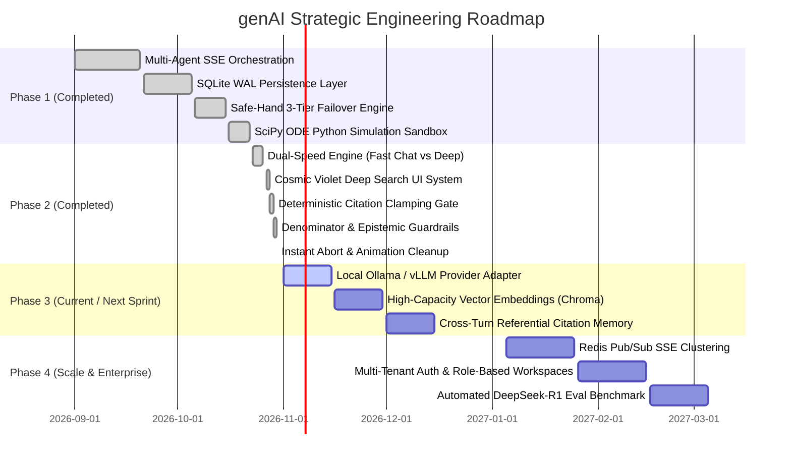

# Implementation Plan & Engineering Roadmap
## genAI: Strategic Execution Plan, Milestones & Verification Matrix

- **Document Version:** 2.4.0
- **Horizon:** Q4 2026 – Q2 2027
- **Target Architecture:** Autonomous Multi-Agent Epistemic Platform
- **Status:** Approved / Active

---

## 1. Engineering Phase Roadmap



---

## 2. Phase-by-Phase Technical Deliverables

### Phase 1: Core Foundation (Completed ✅)
- **1.1 Multi-Agent Pipeline:** Built `agents/stream_orchestrator.py` managing the 5-agent sequence (Thorne, Rostova, Vance, Chen, Sterling).
- **1.2 Real-time SSE Streaming:** Engineered `GET /api/stream` streaming structured JSON event types.
- **1.3 Persistent Database Layer:** Implemented `database/db.py` utilizing SQLite 3 with Write-Ahead Logging (`WAL`) mode.
- **1.4 Mathematical Simulation:** Integrated `tools/tools.py` executing isolated SciPy `solve_ivp` differential equation simulations with dynamic Matplotlib rendering.

### Phase 2: Production Hardening & Epistemic Guardrails (Completed ✅)
- **2.1 Dual-Speed Search Engine:**
  - Added fast single-agent Chat Mode (`mode="simple"`) delivering $< 1\text{s}$ TTFT and $< 3.8\text{s}$ total turn latency.
  - Preserved deep 5-agent research mode for complex academic inquiries.
- **2.2 Cosmic Deep Search UI & Input Bar Refactor:**
  - Replaced legacy web search controls with a dedicated Cosmic Violet/Indigo Deep Search button.
  - Relocated paperclip upload directly into the floating search bar.
  - Streamlined sidebar and cleaned up obsolete action buttons.
- **2.3 Deterministic Citation Clamping Gate:**
  - Engineered `DeterministicRuleBasedVerifier.audit_and_sanitize_citations` in `agents/test_time_compute.py`.
  - Deterministically clamps out-of-bounds citations `[n]` in $< 1\text{ms}$, eliminating hallucinated references.
- **2.4 Denominator & Baseline Guardrails:**
  - Enforced mandatory population denominators on percentages and timeline speedup claims.
  - Introduced `> ⚠️ Epistemic Note:` callout blocks for unverified empirical assertions.
- **2.5 Graceful Abort & Animation Cleanup:**
  - Engineered `cleanupTurnStoppedState(turnId)` in `templates/index.html` to eliminate orphaned CSS spinning spinners upon pressing Stop (⏹).

### Phase 3: Short-Term Milestones (Sprint Q4 2026)
- **3.1 Local LLM Provider Adapter (Ollama / vLLM):**
  - Add native provider support for self-hosted models (e.g., `deepseek-r1:8b`, `llama3.3:70b`, `qwen2.5:32b`).
  - Configure automatic local fallback before reaching cloud serverless tiers.
- **3.2 In-Memory Semantic Vector Store (ChromaDB / SQLite-VSS):**
  - Enable chunked vector search for uploaded textbooks and 100+ page PDF monographs.
  - Deliver sub-page exact citation anchoring: `[1:p.42]`.
- **3.3 Multi-Turn Referential Citation Linking:**
  - Allow questions in turn 4 to reference source `[2]` from turn 1 without re-fetching from the web.

### Phase 4: Enterprise Scale & Automated Evaluation (Q1 2027)
- **4.1 Redis Pub/Sub Distributed SSE Streaming:**
  - Decouple SSE streams from local Python process memory to support clustered multi-worker deployments behind Nginx.
- **4.2 Multi-Tenant Workspace Security:**
  - Add OAuth2 / JWT authentication, private user research notebooks, and role-based access control.
- **4.3 Automated Epistemic Benchmark Suite:**
  - Continuous CI evaluation against a benchmark dataset of 500 scientific papers.
  - Automated detection of metric hallucinations, baseline omissions, and unsupported claims.

---

## 3. Testing, Verification & Quality Gates

```
┌────────────────────────────────────────────────────────────────────────┐
│                        QUALITY GATES MATRIX                            │
└────────────────────────────────────────────────────────────────────────┘

  Gate 1: Unit & Deterministic Verifier Tests
  ├── Test Suite:              tests/test_citation_clamping.py
  ├── Assertion:               Out-of-bounds citation [8] clamped to [valid_count]
  └── Execution Time:          < 50ms (pytest)

  Gate 2: Denominator & Metric Guardrail Tests
  ├── Test Suite:              tests/test_denominator_guardrails.py
  ├── Assertion:               Unconditioned percentages rejected by Critic
  └── Execution Time:          < 100ms

  Gate 3: Safe-Hand Failover Integration Tests
  ├── Test Suite:              tests/test_failover_resilience.py
  ├── Assertion:               Simulate HTTP 429 quota exhaustion ->
  │                            Automatically routes to Pollinations Tier 2
  └── Execution Time:          < 2.5s

  Gate 4: End-to-End Latency & Stream Performance
  ├── Test Suite:              tests/test_stream_latency.py
  ├── Metric:                  TTFT < 1,000ms on simple mode
  └── Metric:                  Zero CSS animation leaks after abort
```

---

## 4. Risk Assessment & Mitigation Strategies

| Risk Description | Probability | Impact | Mitigation Strategy |
| :--- | :--- | :--- | :--- |
| **Gemini Rate Limit (HTTP 429)** | Medium | High | Automatic 3-tier Safe-Hand failover switches instantaneously to Pollinations serverless or offline local synthesis without dropping client connection. |
| **Large PDF Memory Bloat** | Low | Medium | Strict 20MB file upload limit; extract text on upload stream, persist extracted chunks into SQLite, and discard raw in-memory buffers. |
| **Malicious Code in Simulation** | Low | High | Regex AST whitelist blocking `os`, `sys`, `subprocess`, `socket`, `shutil` before executing SciPy code in an isolated subprocess with a 15-second wall-clock ceiling. |
| **Browser Connection Drop Mid-Stream** | Medium | Low | Client rehydrates turn state automatically on reload via `GET /api/session/{session_id}`. Completed turns are persisted in SQLite WAL. |

---

## 5. Deployment & Execution Runbook

### Local Development / Evaluation:
```bash
# 1. Activate Python virtual environment
.\.venv\Scripts\Activate.ps1

# 2. Install dependencies
pip install -r requirements.txt

# 3. Launch live uvicorn ASGI server
python -m uvicorn app:app --host 127.0.0.1 --port 8000 --reload
```

### Production Container Deployment:
```bash
# Build production Docker container
docker build -t genai-epistemic-engine:v2.4 .

# Run production container with mounted database and output volumes
docker run -d -p 8000:8000 \
  -v $(pwd)/data:/app/data \
  -v $(pwd)/output:/app/output \
  -v $(pwd)/uploaded_papers:/app/uploaded_papers \
  --env-file .env \
  --name genai-live genai-epistemic-engine:v2.4
```
