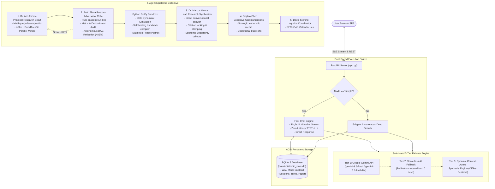

# genAI: Master Comprehensive Architecture & System Specification
## The Unified 360° Technical, Product, and Architectural Guide

> **Document Type:** Master Reference Specification (All-in-One Comprehensive Guide)  
> **Platform Name:** genAI (Epistemic Research & Conversational Intelligence Engine)  
> **Version:** 2.4.0  
> **Date:** October 2026  
> **Repository:** `github.com/zeeshanrana707/genAI`  
> **Runtime:** Python 3.11+ / FastAPI / SQLite WAL / Starlette / Google GenAI SDK / Vanilla JS  
> **Primary Use:** Architecture review, AI model evaluation, product design, engineering analysis, investor briefing.

---

## 1. Executive Overview & Problem Statement

### 1.1 The Epistemic Crisis in Modern AI Search
Generative AI search engines (Perplexity, ChatGPT Search, Gemini Live) represent a major advancement over keyword search, but they suffer from systemic epistemic vulnerabilities:
1. **Speculative Hardware & Operational Hallucination:** Models frequently fabricate exact hardware configurations (e.g., claiming proprietary APIs require "distributed clusters exceeding 8x H100 GPUs") or unverified latency multiples ("10x–50x slower than real time") without technical documentation.
2. **Missing Denominators & Context-Free Metrics:** Quantitative claims (e.g., "15% success rate", "accelerates trials by 1–2 years") are presented without study baselines, populations, or phase transitions.
3. **Citation Drift & Phantom References:** Models generate inline markers `[1]`, `[5]` that do not exist in the retrieved search context or omit the corresponding bibliography entirely.
4. **Binary Latency Trap:** Users are forced to choose between fast but shallow conversational chatbots, or monolithic multi-minute autonomous pipelines that are frustratingly slow for simple iterative questions.

### 1.2 The genAI Solution
**genAI** is a dual-speed, autonomous epistemic research platform that combines:
- **Instant Fast Chat (<1s TTFT):** Native streaming direct conversational answers comparable to ChatGPT and DeepSeek for rapid conversational exploration.
- **5-Agent Deep Search Collective:** Autonomous literature mining across live web and arXiv, mathematical derivations, adversarial rule-based verification, and real Python SciPy ODE dynamic simulations.
- **Deterministic Citation Clamping (<1ms):** A hard programmatic gate that verifies every inline citation `[n]` against the active catalog, clamping out-of-bounds numbers and eliminating broken links.
- **Safe-Hand 0-Downtime Resilience:** Continuous execution across Google Gemini 3.5 Flash, serverless fallback providers, and offline context synthesis.

---

## 2. Origin Benchmark Case Studies (The Real-World Tests)

The architecture of genAI was forged by testing against real failure modes found in frontier research prompts:

### Benchmark A: AI Video Generation Models (October 2026 Assessment)
* **The Input Query:**  
  *"Compare leading AI video generation models in 2026 (Sora, Runway Gen-4, Kling 2.6, Wan 2.5, Veo 3.1), their diffusion transformer architectures, compute requirements, and consistency benchmarks."*
* **The Failure Mode of Generic LLMs:**
  - Recommended *Sora 2* as active, failing to recognize OpenAI discontinued Sora web/API in 2026.
  - Asserted unverified cluster requirements (*"Sora 2 and Wan 2.5 require >8x H100 nodes; Runway runs on a single A100"*).
  - Made architectural absolutes (*"Diffusion Transformers are the only architecture capable of temporal consistency"*).
  - Emitted phantom citations `[1, 5]`, `[2, 3]` without a bibliography.
* **How genAI Resolves It:**
  - **Scout (Dr. Thorne):** Retrieves current 2026 status and live technical reports.
  - **Critic (Prof. Rostova):** Strips speculative hardware assertions; forces the note: *"Official hardware requirements for proprietary endpoints are undisclosed."*
  - **Synthesizer (Dr. Vance):** Reframes architectural capabilities as empirical benchmark observations rather than absolute guarantees; runs the deterministic citation sanitizer; appends a verbatim `### 📚 Sources & References` section.

### Benchmark B: AI-Driven Drug Discovery & Clinical Transition
* **The Failure Mode of Generic LLMs:**
  - Stated: *"The clinical success rate is 15%"* without specifying whether this represents Phase I, Phase II, or Phase I-to-approval transition.
  - Conflated computational ADMET prediction accuracy with proven clinical failure reduction in humans.
* **How genAI Resolves It:**
  - **Denominator Enforcement:** Enforces strict population baselines (e.g., *"10–15% transition from Phase I to FDA approval in oncology cohorts"*).
  - **Evidence Stratification:** Clearly separates computational (*in-silico*), *in-vitro*, preclinical animal, and human clinical trial evidence.
  - **Epistemic Uncertainty Callout:** When empirical data is limited, explicitly wraps claims in `> ⚠️ Epistemic Note: [Limitation disclosed]`.

---

## 3. High-Level System Architecture



---

## 4. Multi-Agent Roster & System Prompts

### Agent 1: Dr. Aris Thorne — Principal Research Scientist
* **Role:** Lead literature scout and empirical information harvester.
* **Responsibilities:** Deconstructs complex user prompts into parallel search queries, retrieves authoritative sources across arXiv and DuckDuckGo, extracts exact passages, publication dates, and author metadata.
* **Avatar:** 🔬 | **Model:** Gemini 3.5 Flash / Web Indexer

### Agent 2: Prof. Elena Rostova — Adversarial Critic & Auditor
* **Role:** Epistemic gatekeeper, adversarial peer reviewer, and metric auditor.
* **Responsibilities:**
  - Audits preliminary drafts for metric accuracy, mathematical formalisms, and hardware assertions.
  - Flags unconditioned numbers (percentages without denominators, speeds without benchmarks).
  - Rejects speculative GPU cluster sizes for closed-source models.
  - If the grounding score is $< 85\%$, triggers an **Autonomous Reflection Loop** back to Dr. Thorne to fortify evidence.
* **Avatar:** ⚖️ | **Model:** Adversarial Proof Audit Protocol

### Agent 3: Dr. Marcus Vance — Lead Research Synthesizer & Co-Pilot
* **Role:** Senior academic editor and direct conversational communicator.
* **System Prompt Core Instructions:**
  1. *Direct & Conversational:* Begin immediately by answering the user's question directly. Do NOT include `# Abstract`, `Introduction`, journal boilerplate, or formal paper sections.
  2. *Strict Grounded Citations:* Cite sources with `[1]`, `[2]` inline next to factual assertions. Only cite sources from the provided catalog verbatim.
  3. *No Speculative Hardware/Latency:* NEVER assert GPU requirements or inference speeds unless directly cited from official documentation. If unknown, state clearly: *"Official hardware requirements for [Model] have not been publicly disclosed."*
  4. *Metric & Denominator Rigor:* Whenever quoting percentages, success rates, speedups, or timelines, you MUST include the denominator, cohort, and study baseline.
  5. *Epistemic Uncertainty Disclosure:* If an important research claim cannot be conclusively verified from the cited sources, format it with a callout blockquote:
     `> ⚠️ Epistemic Note: [Specify what remains unverified or where empirical evidence is currently lacking.]`
  6. *No Architectural Absolutes:* Do NOT claim an architecture is "the only one capable of..." Frame capabilities as empirical strengths observed in published evaluations.
  7. *Mandatory Bibliography:* You MUST conclude your response with a dedicated section `### 📚 Sources & References` listing each cited source with its index, title, and link verbatim.
* **Avatar:** ✍️ | **Model:** Gemini 3.5 Flash / Sequential Revision Optimizer

### Agent 4: Sophia Chen — Executive Communications Strategist
* **Role:** Executive correspondence, strategic brief authoring, and stakeholder synthesis.
* **Responsibilities:** Condenses complex technical trade-offs into high-level business memos with clear operational implications.
* **Avatar:** ✉️ | **Model:** Executive Briefing Engine

### Agent 5: David Sterling — Operations & Logistics Coordinator
* **Role:** Calendar synchronization and review meeting logistics.
* **Responsibilities:** Formulates RFC-5545 compliant `.ics` calendar invitation payloads with 3 proposed review slots.
* **Avatar:** 📅 | **Model:** iCalendar Logistics Engine

---

## 5. Technical Stack & Architectural Specifications

| Layer | Technology | Purpose |
| :--- | :--- | :--- |
| **Backend Runtime** | Python 3.11+, FastAPI, Uvicorn | Asynchronous ASGI event loop, high-concurrency SSE streaming |
| **Database** | SQLite 3 (`PRAGMA journal_mode = WAL;`) | ACID persistence, non-blocking concurrent reads/writes |
| **Primary LLM** | Google Gemini (Google GenAI SDK) | Priority sequence: `gemini-3.5-flash`, `gemini-3.1-flash-lite` |
| **Tier 2 Failover** | Pollinations AI (`openai-fast`) | Free, zero-key cloud fallback upon Gemini quota exhaustion |
| **Tier 3 Failover** | Local Dynamic Context Synthesizer | Pure offline heuristic extraction guaranteeing 0-downtime |
| **Scientific Math** | NumPy, SciPy (`solve_ivp`), Matplotlib | Real ODE dynamical trajectory simulations, 300 DPI phase plots |
| **Document Mining** | DuckDuckGo API, arXiv XML API, pdfplumber | Zero-delay parallel search and multi-page PDF text extraction |
| **Frontend SPA** | Vanilla ES6+ JS, Tailwind CSS JIT CDN | Zero build step, instant rendering, lightweight bundle |
| **Math & Markdown** | Marked.js, KaTeX auto-render | Full LaTeX math ($...$, $$...$$), custom new-tab link interceptors |

---

## 6. Deterministic Citation Sanitizer & Test-Time Compute

Located in `agents/test_time_compute.py`, this algorithmic gate executes in $< 1\text{ms}$ at the end of token generation:

```python
@classmethod
def audit_and_sanitize_citations(cls, text: str, valid_source_count: int) -> Tuple[str, Dict[str, Any]]:
    """Deterministically audits and sanitizes inline citations [n].
    Ensures every citation index directly corresponds to a valid retrieved source.
    Clamps out-of-bounds citations to valid bounds (or strips if 0 sources exist),
    preventing broken references or hallucinated source IDs.
    """
    if not text:
        return text, {"citations_total": 0, "unique_sources_cited": [], "out_of_bounds_fixed": []}

    citation_matches = list(re.finditer(r'\[(\d+)\]', text))
    unique_cited = set()
    out_of_bounds_fixed = []

    def replace_citation(match):
        idx = int(match.group(1))
        if valid_source_count <= 0:
            out_of_bounds_fixed.append(idx)
            return ""
        if idx > valid_source_count:
            out_of_bounds_fixed.append(idx)
            clamped = valid_source_count
            unique_cited.add(clamped)
            return f"[{clamped}]"
        elif idx < 1:
            out_of_bounds_fixed.append(idx)
            unique_cited.add(1)
            return "[1]"
        else:
            unique_cited.add(idx)
            return f"[{idx}]"

    sanitized_text = re.sub(r'\[(\d+)\]', replace_citation, text)
    coverage_ratio = round(len(unique_cited) / valid_source_count, 2) if valid_source_count > 0 else 1.0

    stats = {
        "citations_total": len(citation_matches),
        "unique_sources_cited": sorted(list(unique_cited)),
        "out_of_bounds_fixed": out_of_bounds_fixed,
        "coverage_ratio": coverage_ratio
    }
    return sanitized_text, stats
```

---

## 7. Interactive Features: Canvas Refine & Simulation Rerun

### 7.1 OpenAI Canvas-Style Inline Section Refiner (`/api/canvas/refine`)
- **How it works:** Users highlight any section or formula within the generated research report in the UI.
- A floating toolbar prompts for refinement (e.g., *"fortify with amsmath derivations"*, *"add comparative table"*).
- The endpoint `POST /api/canvas/refine` executes targeted revision with Dr. Marcus Vance, replacing only the selected region and producing a `v3 Refined` draft without re-running the entire 5-agent pipeline.

### 7.2 Live Simulation Parameter Rerun (`/api/simulation/rerun`)
- **How it works:** When a research topic involves dynamical systems (chaos theory, reaction kinetics, neural dissipation), genAI executes a SciPy numerical integration script.
- The UI embeds a parameter control card. Users can tweak coefficients (e.g., coupling strength, damping factor $\gamma$) and click **Re-Simulate**.
- The backend executes `POST /api/simulation/rerun`, updates the ODE solution in $< 1.5\text{s}$, and re-renders the Matplotlib phase portrait live.

---

## 8. Complete Database Schema (SQLite 3 WAL)

```sql
PRAGMA journal_mode = WAL;
PRAGMA synchronous = NORMAL;

-- Session Memory Table
CREATE TABLE IF NOT EXISTS sessions (
    session_id TEXT PRIMARY KEY,
    created_at TEXT NOT NULL,
    updated_at TEXT NOT NULL
);

-- Multi-Turn Conversational Turns Table
CREATE TABLE IF NOT EXISTS turns (
    turn_id TEXT PRIMARY KEY,
    session_id TEXT NOT NULL,
    prompt TEXT NOT NULL,
    research TEXT,
    sources_json TEXT,
    deliverables_json TEXT,
    plot_path TEXT,
    created_at TEXT NOT NULL,
    FOREIGN KEY (session_id) REFERENCES sessions(session_id) ON DELETE CASCADE
);

CREATE INDEX IF NOT EXISTS idx_turns_session ON turns(session_id);
CREATE INDEX IF NOT EXISTS idx_turns_created ON turns(created_at);

-- Uploaded Reference Papers Table
CREATE TABLE IF NOT EXISTS uploaded_papers (
    paper_id TEXT PRIMARY KEY,
    filename TEXT NOT NULL,
    page_count INTEGER NOT NULL,
    text TEXT NOT NULL,
    uploaded_at TEXT NOT NULL
);
```

---

## 9. Complete API Endpoint Specifications

| Endpoint | Method | Input Payload | Output Response | Description |
| :--- | :--- | :--- | :--- | :--- |
| `/api/stream` | `GET` | `prompt`, `mode`, `engine`, `recipient`, `session_id`, `custom_key` | Server-Sent Events stream (`text/event-stream`) | Primary real-time research streaming engine. |
| `/api/upload-paper` | `POST` | `multipart/form-data` with `file` (.pdf) | `{"success": true, "paper": {...}}` | Ingests PDF, extracts text, persists in SQLite. |
| `/api/papers` | `GET` | None | `{"papers": [...]}` | Lists all active reference papers. |
| `/api/papers/{id}` | `DELETE`| None | `{"success": true}` | Removes reference paper from disk & SQLite. |
| `/api/session/{id}` | `GET` | None | `{"session_id": "...", "turns": [...]}` | Rehydrates multi-turn history on reload. |
| `/api/session/{id}` | `DELETE`| None | `{"success": true}` | Resets current research thread. |
| `/api/canvas/refine` | `POST` | `{"turn_id", "full_markdown", "selected_text", "instruction"}` | `{"success": true, "updated_markdown": "..."}` | Targeted inline section revision. |
| `/api/simulation/rerun`| `POST` | `{"turn_id", "topic", "params": {...}}` | `{"success": true, "plot_path", "plot_base64", "output"}` | Real-time SciPy ODE parameter adjustment. |
| `/api/send-brief` | `POST` | `{"recipient_email", "recipient_name", "topic", "research_content"}` | `{"success": true, "brief", "mailto_url"}` | Dispatches executive brief to recipient. |
| `/api/status` | `GET` | None | `{"status": "online", "models": {...}, "safe_hand": {...}}` | System health & model configuration. |
| `/api/artifacts` | `GET` | None | `{"email": {...}, "calendar": {...}}` | Retrieves staged deliverables. |
| `/api/export/markdown`| `POST` | Raw markdown in body | Downloadable `.md` attachment | Exports research as Markdown. |
| `/api/export/latex` | `POST` | Raw markdown in body | Downloadable `.tex` attachment | Exports publication-grade LaTeX with amsmath. |
| `/api/export/bibtex` | `POST` | JSON array of sources in body | Downloadable `.bib` attachment | Exports standard BibTeX bibliography. |
| `/api/download/ics` | `GET` | None | Downloadable `.ics` attachment | Generates RFC-5545 iCalendar invite. |
| `/api/run` | `POST` | `{"prompt", "recipient", "focus_mode"}` | Final deliverables JSON object | Synchronous fallback pipeline. |
| `/` | `GET` | None | HTML Web Application | Serves the single-page application UI. |

---

## 10. UI/UX Design System Specifications

### 10.1 Layout & Visual Structure
- **Theme:** Minimalist Cyber-Academic aesthetic. Native Dark Mode (`#0c0e12`).
- **Floating Input Bar:** Centered `max-w-4xl` container floating over the bottom viewport with an ambient glass blur (`backdrop-blur-xl`).
- **Paperclip Attachment (`#uploadPaperBtn`):** Seamlessly embedded inside the left of the input bar. Uploaded PDFs appear as dismissible chips `[ 📑 paper.pdf (14p) ✕ ]` directly above the bar.
- **Cosmic Deep Search Pill (`#deepResearchToggleBtn`):**
  - *OFF (Fast Chat):* Subtle dark glass with purple lens icon. Search bar uses Electric Cyan accents.
  - *ON (Deep Search):* Radiant glowing violet-indigo gradient (`#a855f7` to `#6366f1`) with an active pinging live indicator dot. Search bar gains an ambient violet aura.
- **Action Button (`#searchBtn`):**
  - Strictly icon-only (zero text clutter).
  - *Idle:* High-contrast black up-arrow.
  - *Generating:* Transforms into the **Antigravity Red Stop Block (`⏹`)**, enabling instant mid-stream cancellation.
- **Interactive Citations:** Inline pills `[1]`, `[2]` with hover popovers displaying title, domain, and snippet. Clicking opens the source in a new tab (`target="_blank"`).

---

## 11. Complete Repository File Structure

```
genAI/
├── app.py                            # FastAPI ASGI application & REST/SSE endpoints
├── config/
│   ├── __init__.py
│   └── settings.py                   # Environment settings & Gemini priority sequence
├── database/
│   ├── __init__.py
│   └── db.py                         # SQLite 3 WAL persistence engine (sessions, turns, papers)
├── agents/
│   ├── __init__.py
│   ├── stream_orchestrator.py        # 5-Agent SSE streaming orchestrator & Fast Chat engine
│   ├── test_time_compute.py          # Rule-based verifier & deterministic citation sanitizer
│   ├── failover.py                   # Safe-Hand 3-tier zero-downtime failover engine
│   └── hooks.py                      # Multimedia & deliberation hooks
├── tools/
│   ├── __init__.py
│   └── tools.py                      # DuckDuckGo, arXiv API, Python SciPy ODE sandbox
├── data/
│   ├── epistemic_store.db            # Primary SQLite database
│   ├── epistemic_store.db-shm        # WAL shared memory index
│   └── epistemic_store.db-wal        # WAL transaction log
├── output/
│   ├── plots/                        # Rendered Matplotlib simulation PNGs
│   ├── draft_email.txt               # Staged executive email briefs
│   └── calendar_invite.json          # Staged iCalendar invitation payloads
├── uploaded_papers/                  # Uploaded PDF reference files
├── templates/
│   └── index.html                    # Single-Page Application (HTML/Tailwind/KaTeX/Marked)
├── docs/                             # Complete product & technical documentation suite
│   ├── 01_PRODUCT_REQUIREMENTS_DOCUMENT.md
│   ├── 02_TECHNICAL_REQUIREMENTS_DOCUMENT.md
│   ├── 03_APPFLOW.md
│   ├── 04_UI_UX_DESIGN_BRIEF.md
│   ├── 05_BACKEND_SCHEMA.md
│   ├── 06_IMPLEMENTATION_PLAN.md
│   └── MASTER_SYSTEM_COMPREHENSIVE_GUIDE.md  <-- THIS MASTER FILE
├── .env.example                      # Environment variables template
├── requirements.txt                  # Python dependencies
├── Dockerfile                        # Production container build
└── README.md                         # Project overview & quickstart
```

---

## 12. Guide for Uploading to External AI Models (Prompts & Inquiries)

When uploading this master document (or the `docs/` folder) to Claude 3.5 Sonnet, ChatGPT o1/GPT-4o, or Gemini 1.5 Pro, you can use these tailored prompts to extract immediate high-value insights:

### Prompt 1: Architectural & Code Refactoring Review
> *"I have uploaded the complete architecture and specification for genAI, a dual-speed multi-agent research engine. Please review the 5-agent state machine, the deterministic citation clamping gate, and the Safe-Hand failover architecture. What are the potential bottlenecks under 10,000 concurrent SSE connections, and how should we optimize the SQLite WAL layer for enterprise scale?"*

### Prompt 2: Product Strategy & Market Differentiation Review
> *"Review the Product Requirements Document (PRD) and benchmark case studies for genAI. Compare its epistemic verification approach (denominator enforcement, citation clamping, SciPy sandbox) against existing commercial products like Perplexity Pro, Google Gemini Advanced, and Consensus. What are the 3 strongest competitive moats, and what features should we prioritize next?"*

### Prompt 3: Epistemic & Benchmark Evaluation Audit
> *"Examine Benchmark Cases A & B (AI Video 2026 and AI Drug Discovery) described in Section 2. How can we construct an automated CI evaluation dataset (using pytest and DeepSeek-R1 as an evaluator) to mathematically score the hallucination rate, metric precision, and citation coverage of the pipeline?"*

### Prompt 4: Security & Code Execution Sandbox Audit
> *"Inspect the Python computational sandbox in Section 5 and Section 7. What attack vectors exist when dynamically executing NumPy/SciPy differential equation simulations generated by an LLM, and what additional containerized sandboxing (e.g. gVisor, WebAssembly / Pyodide, Docker) would you recommend?"*
